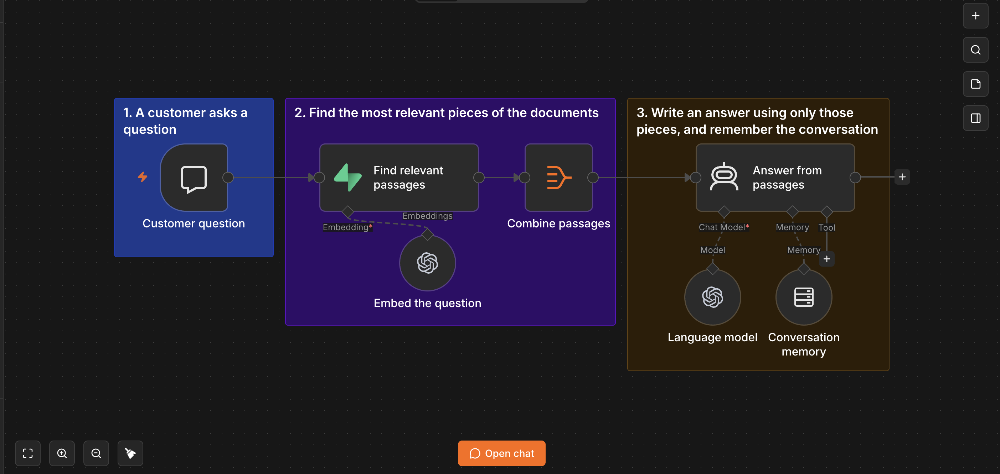
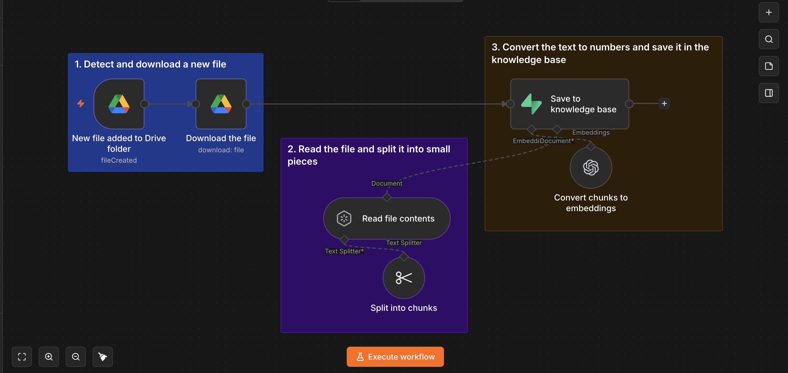
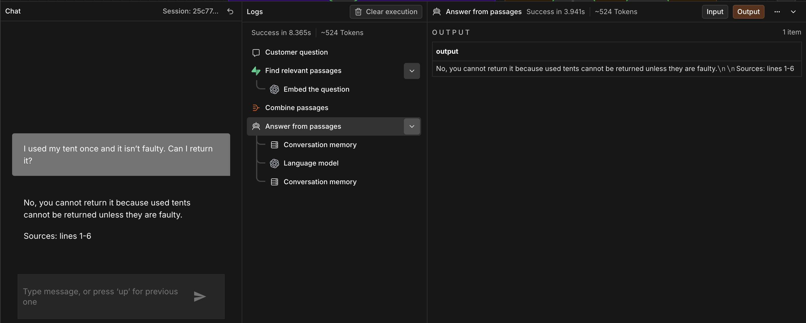
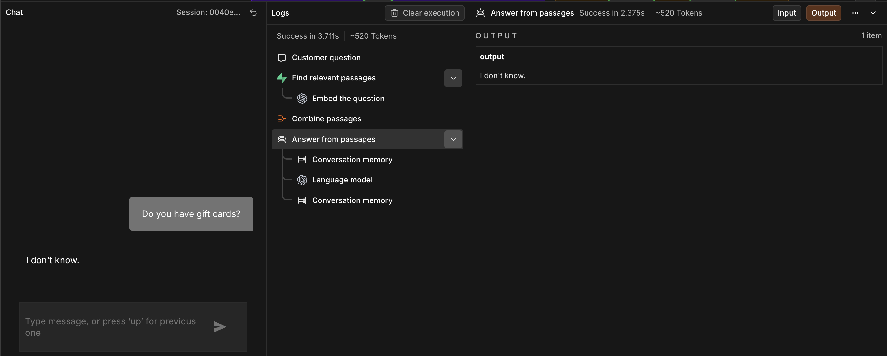

# AI Knowledge Chatbot

Ask questions in plain English and get answers from your own documents, with the source shown.

**Demo video:** [Watch the walkthrough](PASTE_LOOM_LINK_HERE)

## The problem

Most small businesses already have the answers to their customers' questions written down: returns policies, shipping details, product care guides, opening hours. But those answers sit in separate documents, and a person has to find the right one each time someone asks. Customers wait, staff repeat themselves, and the answers can differ depending on who looks them up.

I built an assistant that answers these questions in plain English, using only the business's own files.

## What I built

Two connected n8n workflows:

1. **Document Intake.** When a document is added to a shared Google Drive folder, the workflow reads it, breaks it into small pieces and saves them in a searchable knowledge base.
2. **Chat Assistant.** A customer asks a question in a chat window. The workflow finds the most relevant pieces of the documents and writes an answer from those pieces alone. It ends each answer with the line ranges it used, and it remembers the earlier messages in the conversation.

To test it, I wrote eight short documents for a fictional outdoor-gear shop called Harbour & Pine Outdoor Co., covering returns, shipping, tents, boots, warranty, product care, order support and opening hours. These are demo documents I wrote, not a real client's files. They are in `sample-documents/`.

## How it works

**Adding documents.** A PDF dropped into the Drive folder is downloaded and split into pieces of about 500 characters each. Each piece is converted into a list of numbers that captures its meaning, which is what lets the system search by meaning rather than exact words. The pieces and their numbers are stored in a database. The eight demo documents became 45 stored pieces.

**Answering a question.** The question is converted into numbers in the same way. The database returns the four stored pieces whose meaning is closest. Those four pieces are combined and given to the AI with one strict instruction: answer using only this text, and say "I don't know" if the answer isn't there. A short conversation memory holds the most recent exchanges, so follow-up questions can make sense.

## Design decisions

- **Answer only from the documents.** The AI is told to use the retrieved text and nothing else. This is what stops it inventing policies the business doesn't have.
- **Small pieces.** Storing text in pieces of about 500 characters means the search returns focused passages rather than whole documents.
- **Four passages per question.** Enough to cover an answer that spans two places, without flooding the AI with loosely related text.
- **Show the source.** Each answer ends with the line ranges it was based on, so a person can check it against the document.
- **Locked-down database.** Row-level security is switched on, so the table cannot be read with the public key. The workflows connect with a private key instead.
- **Exact search at demo scale.** With 45 stored pieces I removed the search index. A full comparison is fast and accurate at this size. A larger knowledge base would need an index added back.

## Results

I tested the assistant on nine questions, written to cover different cases: a simple fact, a rule that depends on a condition, a fact needing two passages, a reworded question, questions the documents cannot answer, and a follow-up.

| Outcome | Questions |
|---|---|
| Fully correct | 7 |
| Correct but left out a detail | 1 |
| Wrong | 1 |

- It correctly declined both questions the documents don't cover (whether the shop sells gift cards, and the shop's street address), answering "I don't know" instead of guessing.
- The detail it left out: asked how long an item can be returned, it said 30 days but omitted that the item must be in its original packaging.
- The wrong answer was a very short follow-up. After a question about a jacket's warranty, it could not answer "And on a tent?". Asked in full ("How long is the warranty on a tent?"), it answered correctly: 3 years.

This is one small test on demo documents, so I treat it as a sanity check, not an accuracy rating.

**A problem the testing exposed.** In an earlier round, the assistant misstated the returns rule for used tents. The cause was in how the document had been split: the end of one sentence ("...unless they are faulty") had landed in a separate stored piece from the start of it. I shortened that document so the rule stays in one piece, and the same question was then answered correctly. I fixed this one document. I did not change how documents are split, so the same thing could happen with other long sentences.

## Limitations and next steps

- **Short follow-up questions can fail.** The search only sees the latest message. Next step: rewrite each follow-up into a full question before searching.
- **Citations are line numbers only.** They don't name the file, and I have not checked every range for accuracy. Next step: store the file name with each piece and show it in the answer.
- **Rules can be split across stored pieces.** See the returns example above. Next step: split at paragraph or sentence boundaries, or use larger pieces.
- **Re-running the intake stores a file again.** Documents can end up stored twice if the workflow is run twice on the same file, and I found this during testing. Deleting or editing a file in Drive does not update the knowledge base either. Next step: remove a document's old pieces before saving new ones.
- **Intake is run by hand in this demo.** The workflow is built to start from the Drive folder, but I have not tested running it unattended.
- **Scope.** Only PDFs were tested, and the documents are fictional demo content.

## Run it yourself

You will need n8n, a Supabase project, an OpenAI API key, and a Google Cloud OAuth client with the Drive API enabled.

1. In Supabase, open the SQL Editor and run `sql/setup.sql`.
2. In n8n, import `workflows/document-intake.json` and `workflows/chat-assistant.json`.
3. Create credentials for Supabase (project URL and secret key), OpenAI and Google Drive, then reconnect them in each workflow.
4. In the intake workflow's trigger, choose your own Google Drive folder. The exported file has `YOUR_FOLDER_ID` in its place.
5. Put one PDF in the folder, click Execute workflow once, then remove the PDF from the folder. Repeat for each document. Running it twice on the same file stores it twice.
6. Open the Chat Assistant workflow and click Open chat.

These steps are written from my own build. I have not tested them on a fresh install.

## Repository contents

- `workflows/`: the two n8n workflows
- `sql/setup.sql`: database setup
- `sample-documents/`: eight fictional PDFs for a demo outdoor-gear shop
- `docs/`: screenshots

## Tools

n8n (self-hosted in Docker), OpenAI (text embeddings and the chat model), Supabase (Postgres with the pgvector extension), Google Drive.
